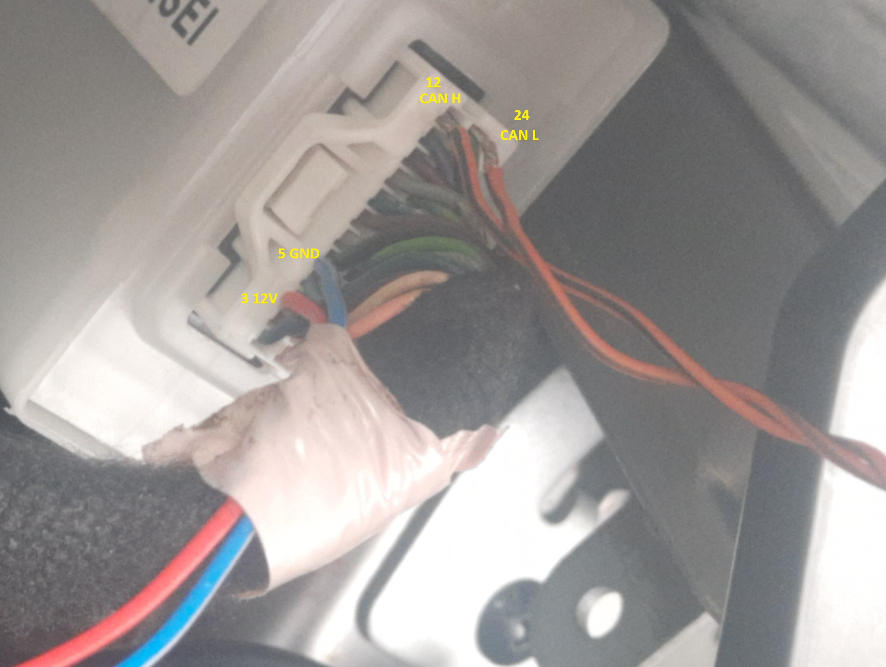
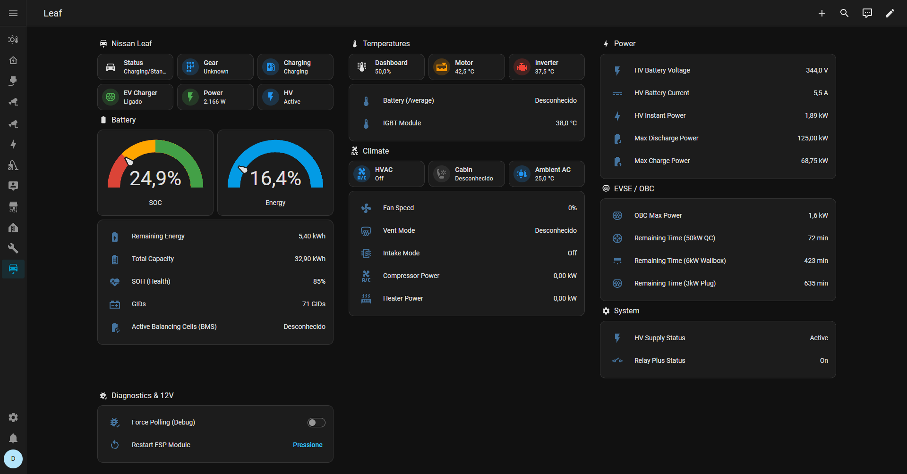

# 🍃 Nissan Leaf ZE1 - ESPHome CAN Monitor (v2.0 Stable)

A powerful, full-featured ESPHome integration to read, query, and decode real-time CAN bus telemetry and deep BMS diagnostics from a **Nissan Leaf ZE1 (40kWh / 62kWh)** directly into Home Assistant.

This project utilizes an **ESP32-C3 SuperMini** paired with an **SN65HVD230** CAN transceiver connected to the vehicle's **EV-CAN** bus. It combines passive frame sniffing with a custom ISO-TP polling engine to extract leafspy-grade metrics without interfering with vehicle safety systems.

---

## ✨ Features & Engineering Highlights

- 🧠 **Non-Blocking ISO-TP BMS Engine:** Features an asynchronous C++ state machine operating inside ESPHome's `on_loop`. Automatically manages multi-frame transfers, flow control (`0x79B`/`0x7BB`), timeouts, and smart retries for querying BMS diagnostic groups (`0x01`, `0x02`, `0x04`, `0x06`, `0x61`, `0x84`).
- 🔋 **96 Cell-Level Voltage Monitoring:** Decodes individual cell voltages in millivolts (mV) across the entire pack, providing real-time tracking for `Cell Min Voltage`, `Cell Max Voltage`, and `Cell Delta Voltage`.
- 🌡️ **4-Point Pack Temperature Array:** Directly reads all 4 internal NTC thermistor sensors inside the high-voltage battery pack alongside motor, inverter, IGBT, and ambient temperatures.
- 📈 **Deep Battery Health & Telemetry:** Extracts native battery health ($HX$), battery capacity in Amp-hours ($Ahr$), high-precision decimal SOH, dual LBC current sensors, insulation resistance, and the battery pack's native serial number.
- ⚖️ **Accurate Cell Balancing / Shunt Tracking:** Corrected 96-cell shunt bitmask decoding (Group `0x06`) combined with passive broadcast monitoring (`0x501`–`0x504`) during charging sessions.
- 🔌 **Physical Charge Time Estimates:** Physical mathematical calculations for 3 kW plug, 6 kW wallbox, and 50 kW Quick Charge completion times based on actual kWh energy deficit.
- 🔴🟢 **Dynamic WS2812 RGB Status LED:** Visual status diagnostics (**Green** = Active CAN traffic within 5s; **Red** = CAN bus offline / timeout).
- ❄️ **HVAC & Climate Diagnostics:** Decodes climate control states, vent modes, intake source, fan voltage/speed, AC power consumption, and PTC heater power.
- 🛡️ **Smart Battery Saver (12V Protection):** Diagnostic polling cycles only execute when the vehicle is `ON`, `ACC`, or `Charging`. When sleeping, the MCU drops to passive listening, preventing 12V vampire drain.

---

## 🛒 Hardware Requirements

1. **Microcontroller:** [ESP32-C3 SuperMini](https://pt.aliexpress.com/item/1005009897797706.html)
2. **CAN Transceiver:** [SN65HVD230 (3.3V)](https://pt.aliexpress.com/item/1005006734943258.html)
3. **Connectors / Cables:** [24p Extension Harness](https://pt.aliexpress.com/item/1005006738154651.html)
4. **Power Supply:** [12V to 3.3V Step-Down Converter](https://pt.aliexpress.com/item/1005006245122273.html) *(powers the ESP32 safely from the vehicle's 12V line)*

---

## 🔌 Wiring & Pinout

The SN65HVD230 transceiver runs natively at 3.3V logic, allowing direct connection to the ESP32-C3 SuperMini.

| ESP32-C3 SuperMini | SN65HVD230 Transceiver |
| :--- | :--- |
| `3.3V` | `3V3` |
| `GND` | `GND` |
| `GPIO4` | `TX` |
| `GPIO3` | `RX` |
| `GPIO8` | Onboard WS2812 RGB LED |

### Nissan Leaf EV-CAN Connection
Connect the transceiver to the vehicle's **EV-CAN** bus behind the gateway or OBD port:
- **CAN-H:** Connect to EV-CAN High
- **CAN-L:** Connect to EV-CAN Low

---

## 🚀 Installation

1. Copy the YAML code from `esp-leaf.yaml` into your ESPHome Dashboard.
2. Update your Wi-Fi credentials and API encryption keys in your ESPHome `secrets.yaml`.
3. Flash your ESP32-C3 SuperMini via USB or OTA.
4. Mount the device in your Nissan Leaf ZE1 and power it up.
5. Home Assistant will automatically discover the `ESP_Leaf` node via native API.

---

## 📊 Home Assistant Dashboard

A pre-configured Lovelace dashboard layout using [Mushroom Cards](https://github.com/piitaya/lovelace-mushroom) is available in `dashboard_layout.yaml`.

1. Install **Mushroom Cards** via HACS.
2. Create a new View in your Home Assistant Dashboard.
3. Edit the View in YAML mode and paste the contents of `dashboard_layout.yaml`.

---

## 🐛 Diagnostics & Manual Querying

- **Wake EV-CAN Bus Button:** Triggers a manual sequential query across all BMS groups (`0x01`, `0x04`, `0x06`, `0x61`) to instantly refresh all sensors.
- **Status LED Diagnostics:** 
  - 🟢 **Solid Green:** Receiving valid CAN bus frames (< 5 seconds ago).
  - 🔴 **Solid Red:** No CAN bus traffic detected (vehicle sleeping or disconnected).

---

## 🙏 Credits & Acknowledgments

- **[CrAzYDr1veR](https://github.com/CrAzYDr1veR):** Original foundation and early testing work for ESPHome Nissan Leaf integrations.
- **[Dala the Great](https://github.com/dalathegreat):** Invaluable CAN bus reverse-engineering, DBC structures, and formulas documented in [leaf_can_bus_messages](https://github.com/dalathegreat/leaf_can_bus_messages).
- **Gareth:** Detailed hardware documentation and integration notes at [Notes on integrating a Nissan Leaf ZE1 and Home Assistant](https://blog.jingo.uk/notes-on-integrating-a-nissan-leaf-ze1-and-home-assistant/).

---

*Disclaimer: This project is intended for educational and diagnostic purposes. Connecting third-party hardware to your vehicle's CAN bus carries inherent risks. Use at your own discretion.*
