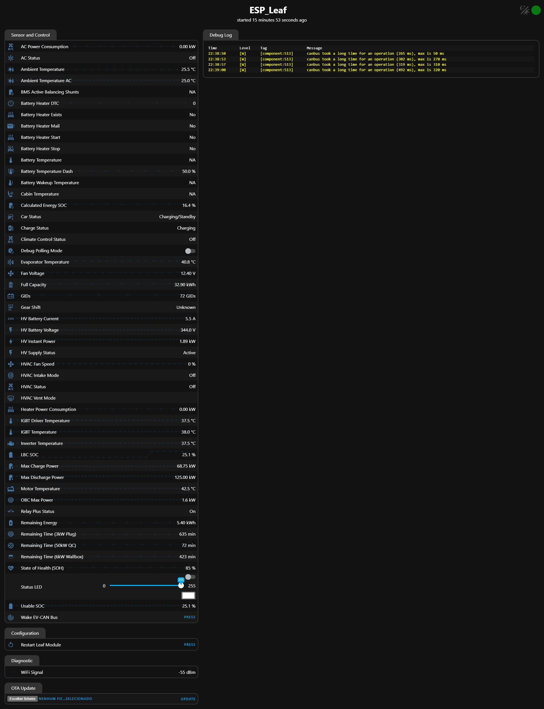
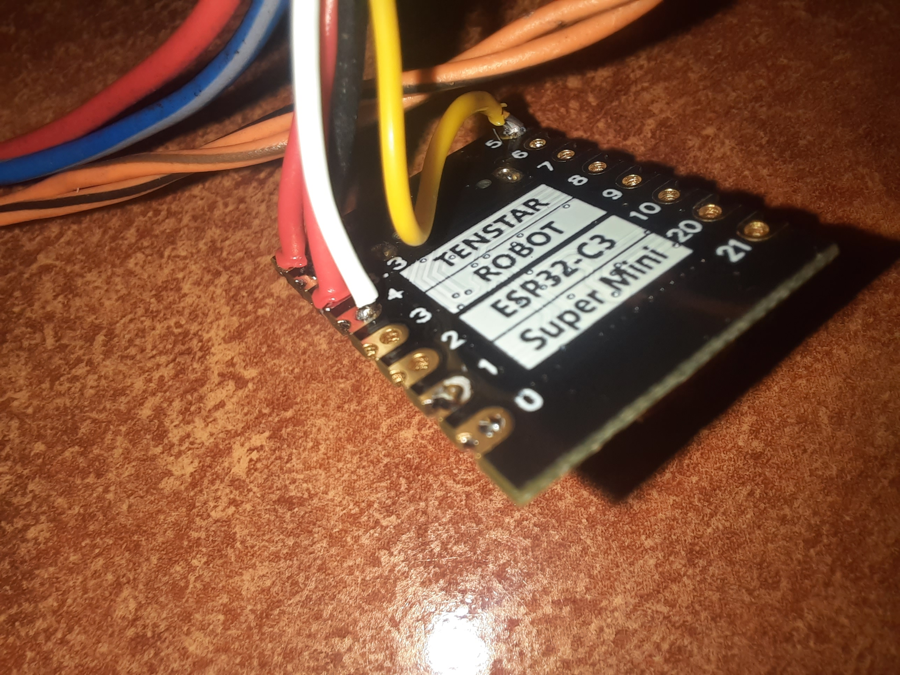
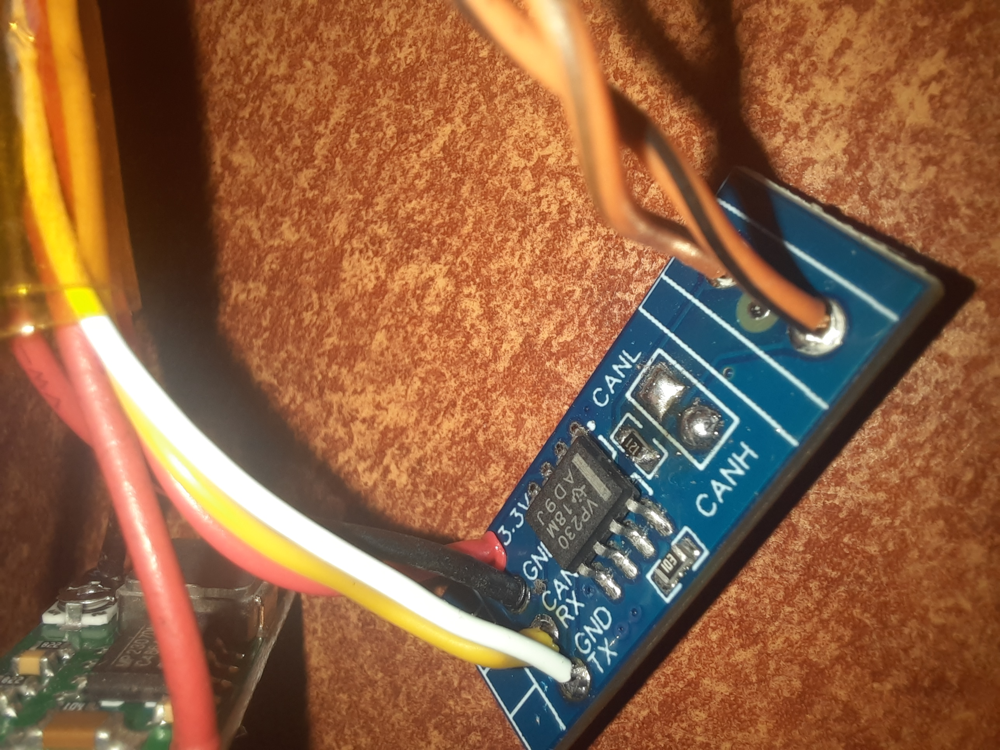
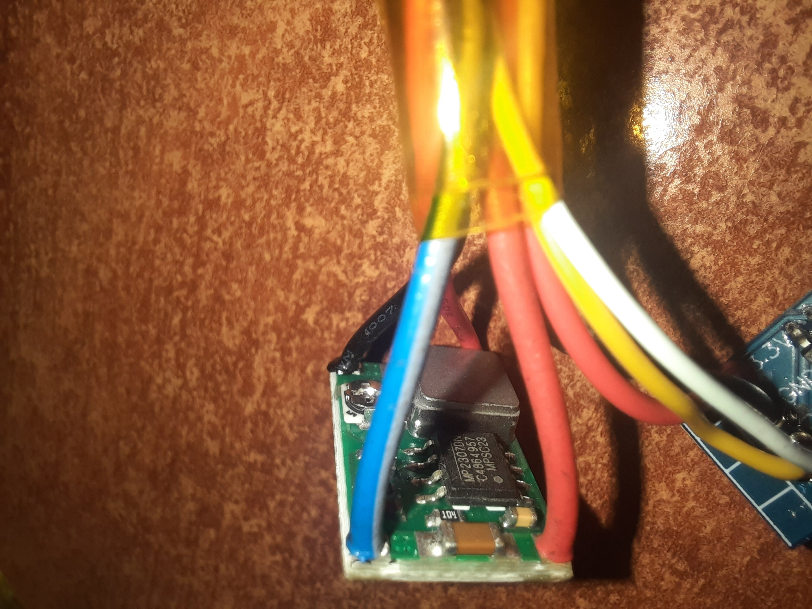

# 🍃 Nissan Leaf ZE1 — ESPHome CAN Monitor

**Monitor your Nissan Leaf ZE1 (40 kWh / 62 kWh) in real time with Home Assistant**

[**✨ Features**](#-key-features) •
[**📊 Previews**](#-previews) •
[**🛒 Hardware**](#-hardware-needed) •
[**🔌 Wiring**](#-wiring-guide) •
[**🚀 Quick Start**](#-quick-start) •
[**🔧 Technical Docs**](TECHNICAL.md)

---

## 📖 About the Project

This project lets you read real-time data from your **Nissan Leaf ZE1 (2018+)** and send it directly to **Home Assistant** over Wi-Fi.

Using a tiny, inexpensive **ESP32-C3** board connected to the car's CAN gateway, you get full visibility into your battery state, charging progress, temperatures, and climate control—without interfering with the vehicle's normal operation.

---

## ✨ Key Features

* **🔋 Complete Battery Insights:** Track State of Charge (SOC), State of Health (SOH), remaining energy (kWh), pack capacity, voltage, current, and real-time power (kW).
* **⚡ Charging & Time Estimates:** Monitor active charging status, maximum charger power, and accurate remaining time until full charge.
* **❄️ Climate & Temperatures:** View cabin, exterior, motor, inverter, and battery pack temperatures, as well as A/C and heater power usage.
* **🛡️ 12V Battery Safe:** Automatically enters passive listening mode when the car is turned off and parked, preventing vampire drain on your 12V battery.
* **📉 Clean & Lightweight Graphs:** Built-in smart filtering eliminates noisy readings and prevents your Home Assistant database from growing unnecessarily.
* **🌐 Standalone Web Interface:** Includes a built-in web page accessible directly from the module's IP or Wi-Fi hotspot, even when away from home.

---

## 📊 Previews

| 🏠 Home Assistant Dashboard | 🌐 Standalone Web UI |
| :---: | :---: |
|  |  |
| *Ready-to-use Lovelace view ([`dashboard_layout.yaml`](dashboard_layout.yaml))* | *Built-in ESPHome Web UI for direct local access* |

---

## 🛒 Hardware Needed

You only need four affordable components to build the module:

| 1. Microcontroller | 2. CAN Transceiver | 3. Power Converter | 4. Gateway Cable |
| :---: | :---: | :---: | :---: |
|  |  |  |  |
| **[ESP32-C3 SuperMini](https://www.aliexpress.com/item/1005009897797706.html)** | **[SN65HVD230 (3.3V)](https://www.aliexpress.com/item/1005006734943258.html)** | **[12V to 3.3V Step-Down](https://www.aliexpress.com/item/1005006245122273.html)** | **[24-Pin Extension Cable](https://www.aliexpress.com/item/1005006738154651.html)** |
| Reads data & connects to Wi-Fi | Translates car CAN signals | Safely powers the ESP32 from 12V | Plug-and-play connection (no cutting wires) |

---

## 🔌 Wiring Guide

The **SN65HVD230** operates at 3.3V, so it wires directly to the **ESP32-C3 SuperMini**:

| ESP32-C3 SuperMini | SN65HVD230 Transceiver | Car Connection (24-Pin Cable) |
| :---: | :---: | :---: |
| `3.3V` | `3V3` | Output from **12V ➔ 3.3V Converter** |
| `GND` | `GND` | Ground (`GND`) |
| `GPIO4` | `TX` | — |
| `GPIO3` | `RX` | — |
| — | `CANH` | **EV-CAN High** |
| — | `CANL` | **EV-CAN Low** |

### 📍 Nissan Leaf Gateway Pinout

---

## 🚀 Quick Start

### 1. Flash the ESP32-C3
1. Open the **ESPHome Dashboard**.
2. Create a new device and use the configuration in [`esp-leaf.yaml`](esp-leaf.yaml).
3. Update your Wi-Fi credentials (`!secret wifi_ssid` and `!secret wifi_password`) and API key, then flash the board.

### 2. Connect to Home Assistant
1. Plug the module into your car's gateway connector.
2. In Home Assistant, go to **Settings ➔ Devices & Services ➔ ESPHome** — your new `ESP_Leaf` device will be discovered automatically.

### 3. Add the Dashboard
1. Install **[Mushroom Cards](https://github.com/piitaya/lovelace-mushroom)** from HACS.
2. Create a new View in your Home Assistant Dashboard, switch to **YAML mode**, and paste the contents of [`dashboard_layout.yaml`](dashboard_layout.yaml).

---

## 📚 Additional Documentation

To keep this guide simple, advanced topics and migration guides are available in separate documents:

* 🔧 **[`TECHNICAL.md`](TECHNICAL.md)** — Deep dive into how the CAN bus decoding works, full list of sensors, BMS polling architecture, and Revision 3 improvements.
* 🔄 **[`HA-PATCH.md`](HA-PATCH.md)** — Upgrading from an older version? Check this guide for renamed entities and ready-to-use Home Assistant patches.

---

## 🙏 Credits & Acknowledgments

This project builds upon the awesome work of the open-source EV community:

* **[CrAzYDr1veR](https://github.com/CrAzYDr1veR)** — Original repository and foundation for this project.
* **[Dala the Great](https://github.com/dalathegreat)** — Extensive Nissan Leaf CAN bus documentation in [`leaf_can_bus_messages`](https://github.com/dalathegreat/leaf_can_bus_messages).
* **[Gareth](https://blog.jingo.uk/notes-on-integrating-a-nissan-leaf-ze1-and-home-assistant/)** — Detailed hardware and wiring guide for the Nissan Leaf ZE1.

---

*⚠️ **Disclaimer:** This project is for educational and diagnostic purposes. Connecting custom hardware to your vehicle's CAN bus carries inherent risks. I am not responsible for any damage to your vehicle, voided warranties, or drained 12V batteries.*

