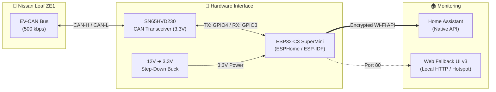

# 🔧 Technical Documentation — Nissan Leaf ZE1 CAN Monitor

This document covers the internal architecture, CAN bus decoding logic, engineering workarounds, and full entity reference for [`esp-leaf.yaml`](esp-leaf.yaml).

---

## 🏗️ System Architecture

---

## 🧠 Engineering Highlights & CAN Bus Workarounds

The Nissan Leaf ZE1 EV-CAN bus has several hardware and protocol quirks that [`esp-leaf.yaml`](esp-leaf.yaml) solves:

### 1. Lossless Multi-Frame ISO-TP (`0x7BB`) Reassembly
* **The Problem:** By default, the ESP-IDF TWAI (CAN) driver uses `rx_queue_len = 0` (holding only 1 pending frame between ISR and the main loop). When polling the Lithium Battery Controller (`0x79B` ➔ `0x7BB`), the BMS replies with a burst of 4 to 8 frames back-to-back, causing consecutive frames (`CF#1`) to drop.
* **The Fix:** The CAN bus configuration sets `rx_queue_len: 64`, `tx_queue_len: 8`, and `max_frames_per_loop: 200`. Furthermore, ISO-TP Flow Control (`0x30 0x00 0x00...`) is dispatched from `on_loop` rather than inside the CAN RX callback, and only when the LBC actually pauses waiting for it (preventing mid-burst sequence resets).

### 2. Rotating Active BMS Polling
When the vehicle is active (`ON`, `ACC`, or `Charging`), the firmware queries one LBC group every **15 seconds** (completing a full cycle every 60 seconds), with automatic up-to-3x retry on incomplete answers:
* **Group `0x01`:** High-resolution SOC (`0.01%`), Pack Capacity (`Ah`), and Battery Health (`HX %`).
* **Group `0x04`:** Four individual battery pack temperature sensors.
* **Group `0x06`:** Active cell balancing shunts count (`cells`).
* **Group `0x61`:** High-precision State of Health (`SOH %`).

### 3. `0x5BC` GIDs Variant Gating
* **The Problem:** Frame `0x5BC` multiplexes the real remaining GIDs (e.g., `214 GIDs`) with the instrument cluster's maximum scale (`500 GIDs`). Without validation, GIDs, charge time estimates, and conditions jump erratically.
* **The Fix:** A C++ variant gate cross-checks incoming `0x5BC` GIDs against the remaining energy from `0x59E` (`GIDs × 80 Wh`) and total pack capacity. Impossible variants are rejected before publishing.

### 4. Home Assistant Database Delta Filtering
* **The Problem:** High-frequency frames like `0x1DB` (sent multiple times per second) oscillate between adjacent quantization steps, generating ~110,000 rows/day in `home-assistant_v2.db` for current alone.
* **The Fix:** Every numeric and text sensor is gated by deadband thresholds (`0.6 A`, `0.6 V`, `0.25 kW` on `0x1DB`, `0.2–0.3 °C` on temperatures, etc.) and only publishes when a meaningful change occurs.

### 5. 12V Battery Protection (Smart Polling)
* Active `0x79B` queries are strictly inhibited when the car is `OFF` and not charging (unless **Debug Polling Mode** is manually enabled). While parked, the ESP32-C3 remains completely silent on the bus.

---

## 📡 Decoded CAN Frames & Entities Reference

### 🔋 Battery, BMS & Charging Sensors

| Entity Name | ID / Entity Suffix | Unit | CAN Frame / Source |
| :--- | :--- | :---: | :--- |
| **Usable SOC** | `usable_soc` | `%` | `0x1DB` (with `LBC Group 1` / `0x55B` fallback) |
| **Usable SOC Source** | `usable_soc_source` | Text | Indicates `Dash 0x1DB`, `LBC group 1`, or `Legacy 0x55B` |
| **Battery SOC (LBC group 1)** | `battery_soc_lbc_group_1` | `%` | `0x7BB` Group 1 (0.01% resolution) |
| **LBC SOC** | `lbc_soc` | `%` | `0x55B` (Legacy LBC SOC) |
| **SOC (GIDs)** | `soc_gids` | `%` | Calculated: `(GIDs × 80 Wh) / Full Capacity` |
| **Calculated Energy SOC** | `calculated_energy_soc` | `%` | `0x59E` (`Remaining Energy / Full Capacity`) |
| **GIDs** | `gids` | `GIDs` | `0x5BC` (Variant-gated, 1 GID = 80 Wh) |
| **Remaining Energy** | `remaining_energy` | `kWh` | `0x59E` |
| **Full Capacity** | `full_capacity` | `kWh` | `0x59E` |
| **Battery Capacity (Ah)** | `battery_capacity_ah` | `Ah` | `0x7BB` Group 1 |
| **State of Health (SOH)** | `state_of_health_soh` | `%` | `0x5BC` |
| **Battery SOH (LBC group 61)** | `battery_soh_lbc_group_61` | `%` | `0x7BB` Group 61 (0.01% resolution) |
| **Battery Health (HX)** | `battery_health_hx` | `%` | `0x7BB` Group 1 |
| **BMS Group 6 Active Shunts** | `bms_group_6_active_shunts` | `cells` | `0x7BB` Group 6 |
| **HV Battery Voltage** | `hv_battery_voltage` | `V` | `0x1DB` |
| **HV Battery Current** | `hv_battery_current` | `A` | `0x1DB` |
| **HV Instant Power** | `hv_instant_power` | `kW` | `0x1DB` (`V × I`) |
| **Max Discharge Power** | `max_discharge_power` | `kW` | `0x1DC` |
| **Max Charge Power** | `max_charge_power` | `kW` | `0x1DC` |
| **OBC Max Power** | `obc_max_power` | `kW` | `0x390` (Gated by AC voltage status) |
| **Remaining Charge Time** | `remaining_charge_time` | `min` | `0x5BC` (`LB_Remain_Charge_Time`) |
| **Charge Time Condition** | `charge_time_condition` | Text | `0x5BC` (Charge mode table) |
| **Charge Status** | `charge_status` | Text | `0x1DB` / `0x390` |

### 🌡️ Temperatures, Climate (HVAC) & Powertrain

| Entity Name | ID / Entity Suffix | Unit | CAN Frame / Source |
| :--- | :--- | :---: | :--- |
| **Battery Temperature** | `battery_temperature` | `°C` | `0x7BB` Group 4 average (or `0x5C0` fallback) |
| **Battery Pack Temperatures** | `battery_pack_temperatures` | Text | `0x7BB` Group 4 (4 probes formatted as text) |
| **Battery Temperature Source** | `battery_temperature_source` | Text | `LBC group 4` or `0x5C0` |
| **Battery Gauge Segment (dash)** | `battery_gauge_segment_dash` | `%` | `0x5BC` (`LB_Temperature_Segment_For_Dash`) |
| **Battery Wakeup Temperature** | `battery_wakeup_temperature` | `°C` | `0x5C0` |
| **Motor Temperature** | `motor_temperature` | `°C` | `0x55A` |
| **Inverter Temperature** | `inverter_temperature` | `°C` | `0x55A` |
| **IGBT / IGBT Driver Temp** | `igbt_temperature` | `°C` | `0x55A` |
| **Ambient Temperature** | `ambient_temperature` | `°C` | `0x54C` |
| **Ambient Temperature AC** | `ambient_temperature_ac` | `°C` | `0x54A` |
| **Cabin Temperature** | `cabin_temperature` | `°C` | `0x54F` |
| **Evaporator Temperature** | `evaporator_temperature` | `°C` | `0x54C` |
| **HVAC / Climate / AC Status** | `hvac_status` / `ac_status` | Text | `0x54B` / `0x54C` |
| **HVAC Vent / Intake Mode** | `hvac_vent_mode` / `intake` | Text | `0x54B` |
| **HVAC Fan Speed & Voltage** | `hvac_fan_speed` / `voltage` | `%` / `V` | `0x54B` / `0x54C` |
| **AC Power Consumption** | `ac_power_consumption` | `kW` | `0x54A` |
| **Heater Power Consumption** | `heater_power_consumption` | `kW` | `0x54C` |
| **Car Status & Gear Shift** | `car_status` / `gear_shift` | Text | `0x11A` / `0x60D` |

### 🛠️ Diagnostic Controls

* **`button.esp_leaf_wake_ev_can_bus` (Wake EV-CAN Bus):** Immediately executes sequential polling of BMS Groups 1, 4, 6, and 61 (300 ms interval).
* **`button.esp_leaf_restart_leaf_module` (Restart Leaf Module):** Reboots the ESP32-C3.
* **`switch.esp_leaf_debug_polling_mode` (Debug Polling Mode):** Forces 15-second active polling regardless of vehicle state. **Use only temporarily for debugging to avoid draining the 12V battery.**

---

## 🔄 Revision 3 Entity Migration

If upgrading from an older configuration, update your Home Assistant entities according to the table below (full patch instructions in **[`HA-PATCH.md`](HA-PATCH.md)**):

| Old / Removed Entity | Use Instead |
| :--- | :--- |
| `sensor.garagem_leaf_esp_lbc_soc` | `sensor.garagem_leaf_esp_usable_soc` or `sensor.garagem_leaf_esp_battery_soc_lbc_group_1` |
| `sensor.garagem_leaf_esp_remaining_time_6kw_wallbox` | `sensor.garagem_leaf_esp_remaining_charge_time` |
| `sensor.garagem_leaf_esp_remaining_time_3kw_plug` | `sensor.garagem_leaf_esp_remaining_charge_time` |
| `sensor.garagem_leaf_esp_remaining_time_50kw_qc` | `sensor.garagem_leaf_esp_remaining_charge_time` |
| `sensor.garagem_leaf_esp_charge_status_sensor` | `sensor.garagem_leaf_esp_charge_status` |
| `sensor.garagem_leaf_esp_bms_active_balancing_shunts` | `sensor.garagem_leaf_esp_bms_group_6_active_shunts` |
| `sensor.garagem_leaf_esp_battery_temperature_dash` | `sensor.garagem_leaf_esp_battery_gauge_segment_dash` |

